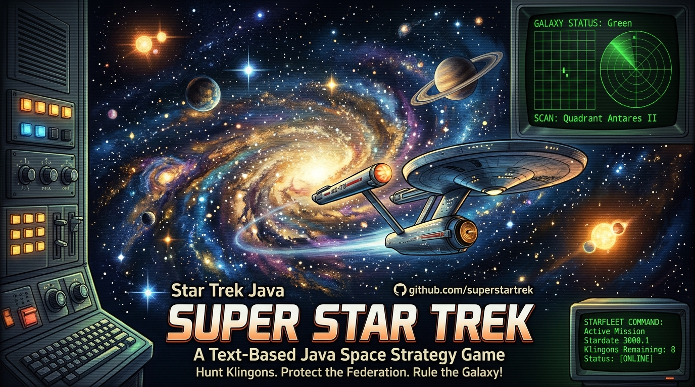

# Super Star Trek (Java)

A text-based remake in Java of the classic 1970s *Super Star Trek* computer game. You command the starship Enterprise, and your mission is to hunt down and destroy the Klingon fleet before it reaches Federation Headquarters.

Everything runs in the terminal. Navigate the galaxy by warp drive, scan for enemies, manage your energy and shields, and fight with phasers and photon torpedoes. Damaged systems can be repaired at a starbase.

```
Short Range Scan for Quadrant 3,5  (Canopus III)
+---+-------+-------+-------+---------+-------+-------+---------+--------+
|   |   1   |   2   |   3   |    4    |   5   |   6   |    7    |   8    |
+---+-------+-------+-------+---------+-------+-------+---------+--------+
| 1 | * x 7 | * x 5 | * x 3 | +K+ x 1 | * x 5 | * x 6 |  * x 5  | * x 5  |
|   |       |       |       |  * x 6  |       |       |         |        |
+---+-------+-------+-------+---------+-------+-------+---------+--------+
| 2 | * x 6 | * x 3 | * x 3 |  * x 2  | * x 6 | * x 2 |  * x 8  | * x 5  |
+---+-------+-------+-------+---------+-------+-------+---------+--------+
| 3 | * x 5 | * x 4 | * x 6 | +C+ x 1 | * x 2 | * x 7 |  * x 6  | * x 1  |
|   |       |       |       |  * x 2  |       |       |         |        |
+---+-------+-------+-------+---------+-------+-------+---------+--------+
| 4 | * x 4 | * x 5 | * x 2 |  * x 4  | * x 5 | * x 3 |  * x 4  | * x 7  |
|   |       |       |       |   <*>   |       |       |         |        |
+---+-------+-------+-------+---------+-------+-------+---------+--------+
   ...
   Stardate            3000.0
   Condition           *RED*
   Photon torpedoes    10
   Total energy        3000
   Shields             0
   Klingons remaining  17
   *** SHIELDS DANGEROUSLY LOW ***
```

## Requirements

- Java 11 or later (JDK)

There are no external dependencies.

## Building and running

From the folder that contains the `superstartrek` package directory:

```bash
javac -d out superstartrek/*.java
java -cp out superstartrek.Run
```

## Your mission

At the start of each game you are told:

- how many Klingon warships have invaded the galaxy (usually 15–25)
- how many stardates you have to destroy them all
- how many starbases are available to resupply you

You **win** if you destroy every Klingon before the deadline. You **lose** in any of these cases:

- the Enterprise is destroyed
- time runs out
- you run out of energy away from a starbase
- you destroy the last starbase
- you resign

## The galaxy

The galaxy is a grid of **8 × 8 quadrants**, and each quadrant is a grid of **8 × 8 sectors**. Coordinates are given as *column, row*, both starting at 1. The galaxy is divided into 16 named regions, such as *Antares*, *Rigel* and *Spica*. Each region is split into quadrants I–IV.

| Symbol | Meaning |
|---|---|
| `<*>` | The Enterprise |
| `+K+` | Klingon battle cruiser |
| `+C+` | Klingon Commander: tougher, and can survive a torpedo |
| `>!<` | Starbase |
| `*` | Star |

After each move the game also prints a close-up of the ship's current sector at parsec resolution. That view uses the single-letter symbols `E`, `K`, `C`, `B` and `*`.

## Commands

| Command | Description |
|---|---|
| `NAV` | Warp engine control: set a course and warp factor |
| `SRS` | Short range scan of the current quadrant, plus ship status |
| `LRS` | Long range scan of the surrounding 3 × 3 quadrants |
| `PHA` | Fire phasers at all Klingons in the quadrant |
| `TOR` | Fire a photon torpedo along a course |
| `SHE` | Shield control: move energy between the ship and the shields |
| `DAM` | Damage control report, and repairs when docked |
| `COM` | Library computer |
| `HELP` | Help for any command |
| `XXX` | Resign your commission |

### Courses

Courses for `NAV` and `TOR` use this compass. Fractions are allowed, so 2.5 is half-way between 2 and 3. Course 9 is the same as course 1.

```
      4  3  2
       \ | /
    5 --<*>-- 1
       / | \
      6  7  8
```

### Warp factor

- **Warp 1** moves one quadrant, which is 8 sectors. **Warp 0.125** moves one sector. The maximum is warp 8.
- A move costs **10 energy plus 1 per sector** travelled.
- A move takes **1 stardate**, or a fraction of one below warp 1.
- Inside your current quadrant, the helm makes an emergency stop before hitting a Klingon, a starbase or a star.
- Starfleet will not let you cross the edge of the galaxy.

### Library computer (`COM`)

| Option | Function |
|---|---|
| `0` | Cumulative galactic record of every quadrant you have scanned |
| `1` | Status report: Klingons left, time remaining, starbases, damage |
| `2` | Photon torpedo data: exact course and distance to each Klingon |
| `3` | Starbase navigation data |
| `4` | Direction/distance calculator, including the warp factor needed |
| `5` | Map of galactic region names |

## Combat

- **Shields** absorb Klingon fire, and they start at **zero**. If a hit takes them to zero, the Enterprise is destroyed, so raise them with `SHE` before entering a fight.
- **Phasers** split the energy you fire between every Klingon in the quadrant. Hits weaken with distance.
- **Photon torpedoes** destroy the first Klingon or starbase whose sector they enter. A Klingon Commander may survive one. A direct hit on a star absorbs the torpedo. Use `COM 2` for an exact firing course.
- **Klingons fire back** after you use phasers or torpedoes, and again when you warp out of their quadrant.
- **Heavy hits can damage ship systems.** A damaged system limits what you can do; for example, damaged warp engines restrict you to warp 0.2. Systems repair slowly as you travel.

## Starbases

End a move next to a starbase (in any of the 8 surrounding sectors) to **dock**. Docking restores your energy and torpedoes and lowers your shields. While docked, the starbase's shields protect you from Klingon fire, and `DAM` offers to repair every damaged system for a small amount of time.

Destroying a starbase costs you 25% of your performance rating. Destroying the last one ends your career.

## Scoring

When you win, your efficiency is calculated as:

```
efficiency = 1000 × (Klingons destroyed ÷ stardates used)²
```

The final score is your efficiency multiplied by your **performance rating**. The rating starts at 100% and drops if you give invalid navigation orders, hit the galactic perimeter or destroy starbases.

## Tips

1. Start with `SRS` and `LRS` to get your bearings, and use `COM 0` to plan a route.
2. Raise shields to at least a few hundred units before entering a quadrant with Klingons.
3. Use `COM 2` before firing torpedoes, and `COM 4` to get the exact course and warp factor to any sector.
4. Dock regularly to refuel, rearm and repair, especially before a deadline gets close.
5. When asked whether to play again, answering **Y** and then **N** to "Same setup" gives you a new randomly generated galaxy.

## Project structure

| File | Role |
|---|---|
| `Run.java` | Entry point, command loop and all game logic |
| `Galaxy.java` | Object store indexed by parsec cell and by quadrant |
| `GalacticPosition.java` | Coordinate conversions: parsecs, quadrants, sectors |
| `Course.java` | Course/vector maths and firing solutions |
| `GameObject.java` | Base class for anything placed in the galaxy |
| `Enterprise.java` | The player's ship: energy, shields, torpedoes, damage |
| `Klingon.java`, `KlingonCommander.java` | Enemy ships |
| `Star.java`, `StarBase.java` | Stars and starbases |
| `Device.java` | The ship systems that can be damaged |
| `LongRangeScan.java`, `ShortRangeScan.java` | The two scanners |
| `TextBox.java`, `TextBoxGrid.java` | Draws the bordered text grids |
| `GameEvent.java`, `GameListener.java` | Event system (ship moved, ship or Klingon destroyed, …) |
| `Vector.java` | General vector maths |

## Acknowledgements

This is a Java remake of *Super Star Trek* by Bob Leedom (1974), which was based on Mike Mayfield's original *Star Trek* (1971). It was popularised by David Ahl's *BASIC Computer Games*. Star Trek is a trademark of its respective owners, and this is a non-commercial fan project.

## Author

Mario Gianota (c) 2026 All rights Reserved
